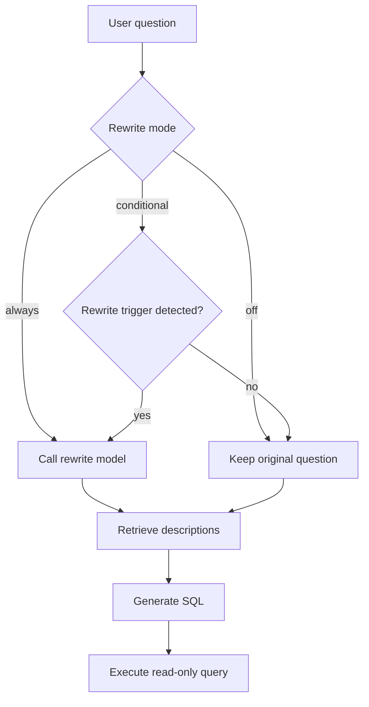

# ENH-001: Selectable question-rewrite modes

## Status

In progress

## Summary

Make question rewriting configurable so the system can compare the current
unconditional rewriting behavior with using the original question and with
rewriting only when it is necessary.

The rewrite mode is a session/request-level setting. It is selected by the CLI
and passed to each agent invocation; it is not part of the persisted agent
definition.

## Updated files

- [`src/main.py`](../src/main.py): adds the `--rewrite-mode` CLI option and
  forwards the selected mode.
- [`src/DatabaseAgent/DatabaseAgent.py`](../src/DatabaseAgent/DatabaseAgent.py):
  applies the request-level `always`, `off`, and conditional behavior based on
  ENH-002 analysis and logs original/rewritten queries.
- [`src/test_main_cli.py`](../src/test_main_cli.py): tests CLI mode forwarding
  and validation.
- [`src/test_question_rewrite_modes.py`](../src/test_question_rewrite_modes.py):
  tests request-level mode-specific query selection and rewrite logging.
- [`readme.md`](../readme.md): documents the CLI option and current conditional
  placeholder.
- [`project-and-enhancements.md`](../project-and-enhancements.md): records the
  enhancement as in progress and updates the offline test count.

ENH-002 now supplies the analysis outcome used by `conditional` mode. The
enhancements remain separately evaluated.

## Modes

### `always`

Rewrite every user question before SQL generation.

This is the current behavior and must remain the baseline for comparison.

### `off`

Do not rewrite the question. Pass the original user question to the SQL
generation flow.

This mode measures the cost and benefit of rewriting against preserving the
user's exact wording.

### `conditional`

Rewrite the question only when there is a clear reason to do so, for example:

- Relative dates such as "today", "recently", or "last month"
- Ambiguous scope or business terminology
- Unclear references such as "those records" or "the previous result"
- Missing information needed to interpret the requested time range or grouping

Questions that are already clear and specific should be passed through without
an additional rewrite call.

Conditional mode now rewrites only when ENH-002 returns `normalize`; it
preserves the original question for `preserve` and blocks on `clarify`.

## Proposed flow

In `conditional` mode, the trigger check should be explicit and testable.
Unresolved business ambiguity should be routed to ENH-002 rather than silently
resolved by rewriting.

## Motivation

The current implementation always makes a separate model call to rewrite the
question. Rewriting may improve interpretation, but it can also add latency,
increase model usage, or unintentionally change the user's meaning.

Selectable modes allow these trade-offs to be measured instead of assumed.

## Experimental requirements

Use the same question set, database, persisted descriptions, retrieval
strategy, SQL-generation settings, and model configuration for each mode.

Record at least:

- The original question
- The rewritten question, when applicable
- The selected mode and conditional decision
- Number of model calls
- End-to-end latency
- Generated SQL
- SQL execution and repair attempts
- Verified result correctness
- Whether rewriting changed the intended meaning

## Acceptance criteria

- `always` remains available and preserves the current baseline behavior.
- `off` sends the original question without a rewrite model call.
- `conditional` has explicit, testable rewrite-decision rules.
- The current conditional placeholder is documented separately from the final
  decision-rule requirement.
- Rewrite decisions and rewritten text are visible in verbose/debug output.
- Existing behavior and all new modes are covered by focused tests.
- Comparisons report SQL correctness, latency, and model-call counts.
- The description-only SQL-generation boundary remains unchanged.

## Out of scope

- Changing table-description generation
- Changing retrieval strategies
- Adding raw schema data to SQL-generation prompts
- Replacing SQL repair behavior
- Claiming that a mode improves model accuracy without comparative evaluation
