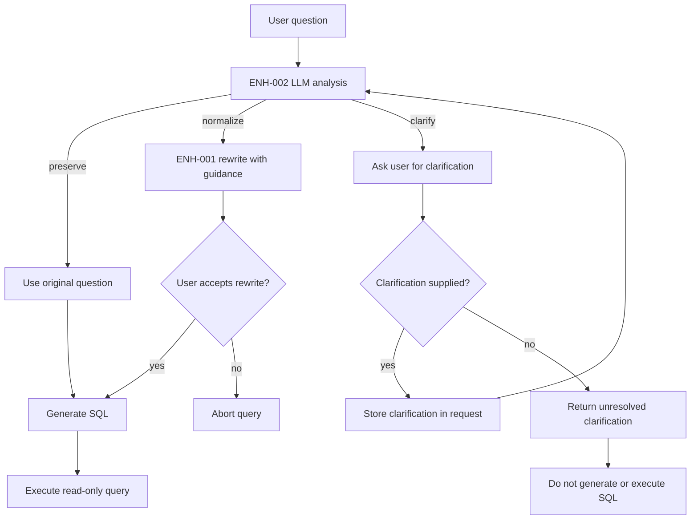

# ENH-002: Structured clarification outcomes

## Status

In progress

## Summary

Prevent the system from silently choosing an ambiguous business definition
before SQL generation. The question-understanding step should return a
structured outcome that determines whether the original question can be used,
whether it should be normalized, or whether the user must clarify it first.

ENH-002 analyzes the question and supplies guidance; it does not rewrite the
query. ENH-001 remains responsible for deciding whether the rewrite prompt is
called and for producing the final rewritten question.

## Updated files

- [`src/DatabaseAgent/DatabaseAgent.py`](../src/DatabaseAgent/DatabaseAgent.py):
  runs structured analysis, blocks unresolved clarification, passes analysis
  guidance to rewriting, and requires rewrite confirmation before SQL.
- [`src/DatabaseAgent/QueryAnalysisResponse.py`](../src/DatabaseAgent/QueryAnalysisResponse.py):
  defines the structured analysis response.
- [`src/DatabaseAgent/Prompts/AnalyzeUserQuery.md`](../src/DatabaseAgent/Prompts/AnalyzeUserQuery.md):
  instructs the analysis model to preserve, normalize, or clarify without
  rewriting.
- [`src/DatabaseAgent/Prompts/RewriteUserQuery.md`](../src/DatabaseAgent/Prompts/RewriteUserQuery.md):
  accepts analysis guidance and user clarification.
- [`src/DatabaseAgent/IPromptProvider.py`](../src/DatabaseAgent/IPromptProvider.py):
  registers the analysis prompt.
- [`src/main.py`](../src/main.py): collects clarification, confirms rewrites,
  aborts rejected queries, and continues interactive input after an abort.
- [`src/test_main_cli.py`](../src/test_main_cli.py): covers request flow and
  CLI behavior.
- [`src/test_question_rewrite_modes.py`](../src/test_question_rewrite_modes.py):
  covers analysis outcomes, clarification blocking, rewrite guidance, and
  confirmation.
- [`readme.md`](../readme.md): documents analysis and confirmation behavior.

## Outcomes

### `preserve`

The question is sufficiently clear and can be passed to SQL generation without
changing its wording.

### `normalize`

The question is clear enough to interpret, but its wording benefits from safe
normalization. ENH-002 returns guidance and ENH-001 may call the rewrite model
with that guidance while preserving the requested scope, measures, filters,
dates, and level of detail.

### `clarify`

The question contains an unresolved ambiguity, such as a business term with
multiple valid meanings. The system must ask the user a clarification question
before generating or executing SQL.

An unresolved `clarify` outcome must never fall through to SQL generation.

## Motivation

Natural-language questions may use terms such as "active", "recent", "large",
or "customer" without defining the business meaning required for a correct
query. Silently selecting one interpretation can produce valid SQL with an
incorrect result.

Structured outcomes make the decision explicit and allow the caller to see
when the system needs more information.

## Example

User question:

> How many active customers do we have?

Possible clarification:

> What should count as an active customer: a recent login, a recent purchase,
> or an active subscription?

After the user answers, the original question and clarification should be
combined into a resolved request. The system may then normalize the request
before SQL generation.

If the user cannot provide a definition, the system should stop with an
explanation or ask a bounded follow-up question. It must not guess a definition
and execute SQL.

## Proposed flow

The `clarify` path must stop before SQL generation until the user supplies
enough information. If the ambiguity remains unresolved after the allowed
attempts, the system returns an explicit unresolved state instead of guessing.
When a rewrite is produced, the interactive caller displays both questions and
requires explicit approval. Simulation/direct non-interactive calls
automatically accept the rewrite.

## Relationship with ENH-001

ENH-001 controls whether question rewriting is enabled:

- `always` always permits normalization.
- `off` uses the original question, but unresolved ambiguity must still be
  handled safely.
- `conditional` can consume these outcomes:
  - `preserve`: use the original question
  - `normalize`: call the rewrite model
  - `clarify`: ask the user and block SQL

The enhancements remain separately identifiable for implementation and
evaluation. A combined `conditional + clarification` condition may be measured
separately.

## Acceptance criteria

- Question analysis returns exactly one explicit outcome: `preserve`,
  `normalize`, or `clarify`.
- Analysis does not produce the rewritten query; it returns guidance only.
- `preserve` retains the original question.
- `normalize` preserves requested measures, filters, dates, scope, and detail.
- `clarify` produces a user-facing clarification request.
- SQL generation and execution are blocked while clarification is unresolved.
- A resolved clarification can be included in a subsequent normalized request.
- Clarification attempts are bounded and do not silently choose a definition.
- Rewritten questions are shown to interactive users before SQL generation.
- Rejecting a rewrite aborts the query without SQL generation or execution.
- Tests cover clear, safely normalizable, ambiguous, resolved, and unresolved
  questions.
- The outcome and clarification state are visible in verbose/debug output.

## Out of scope

- Changing table-description generation
- Changing retrieval strategies
- Adding raw schema data to SQL-generation prompts
- Defining business meanings without user or application-provided rules
- Replacing SQL validation or read-only execution filters
