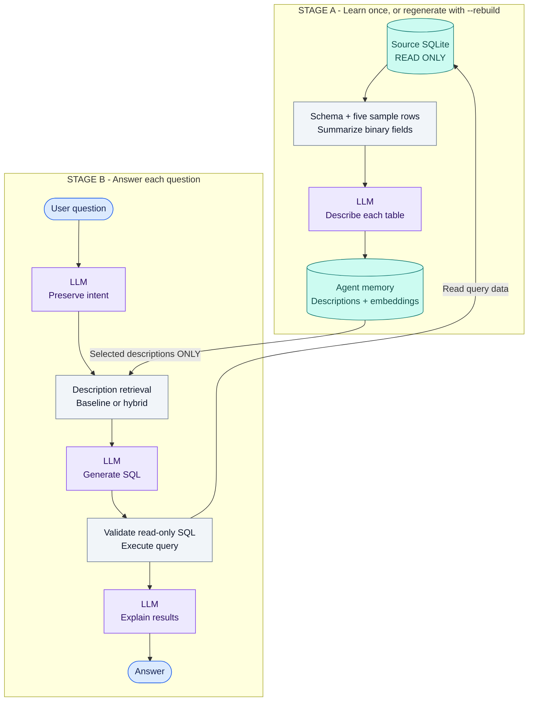
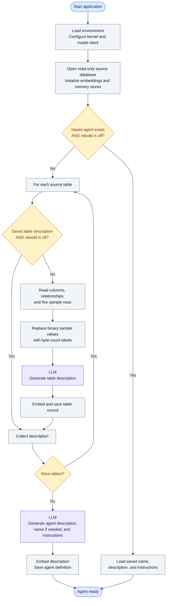
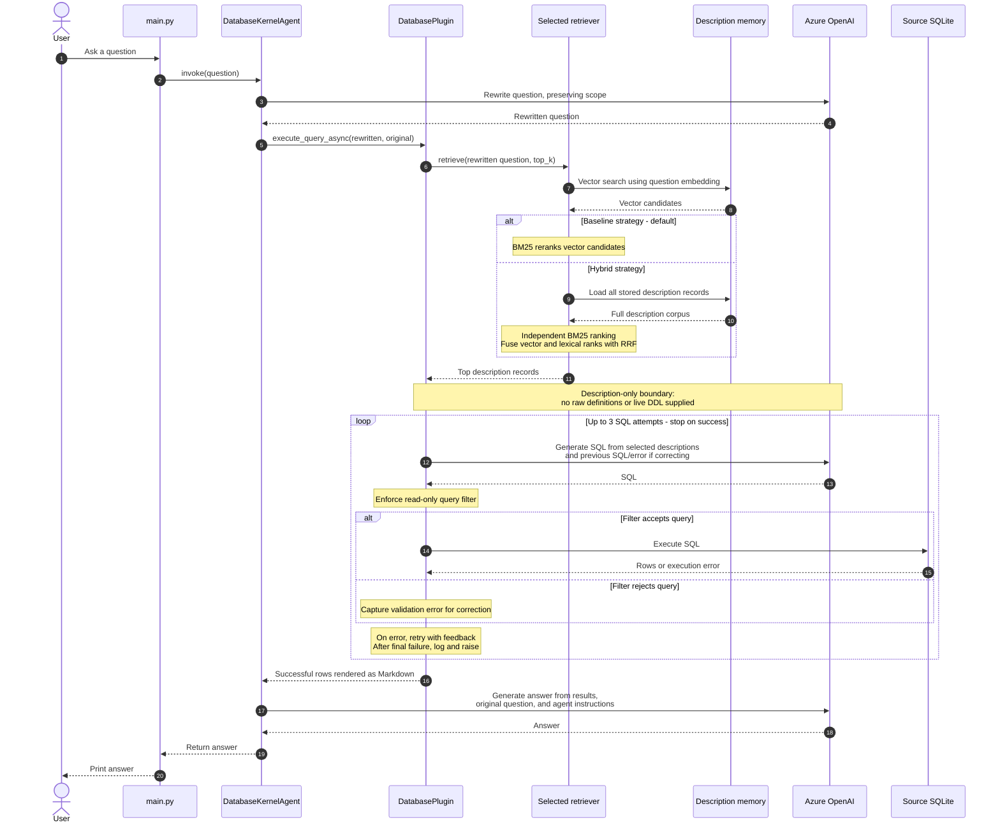
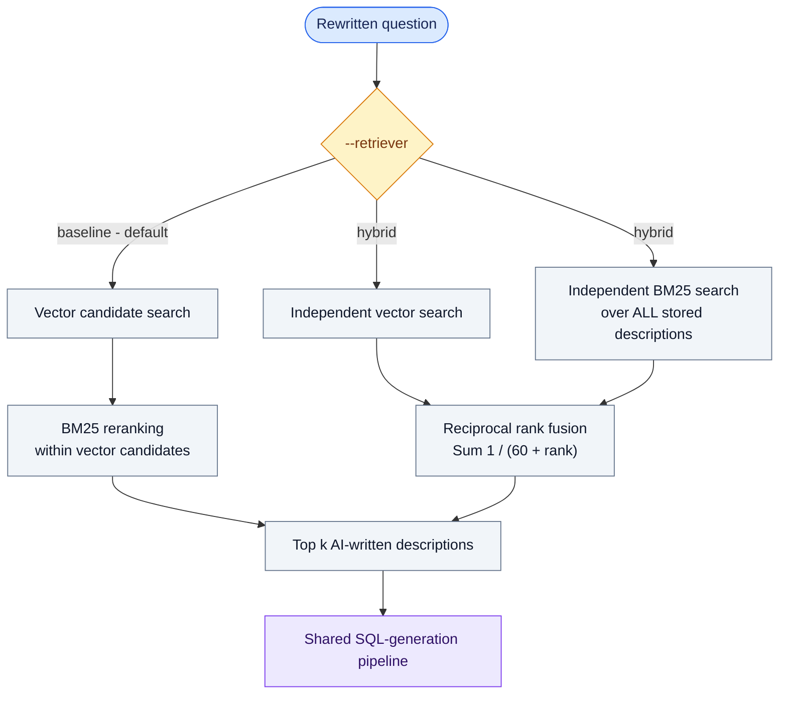
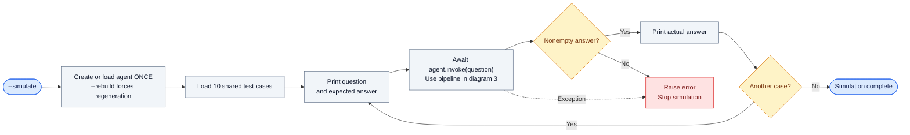
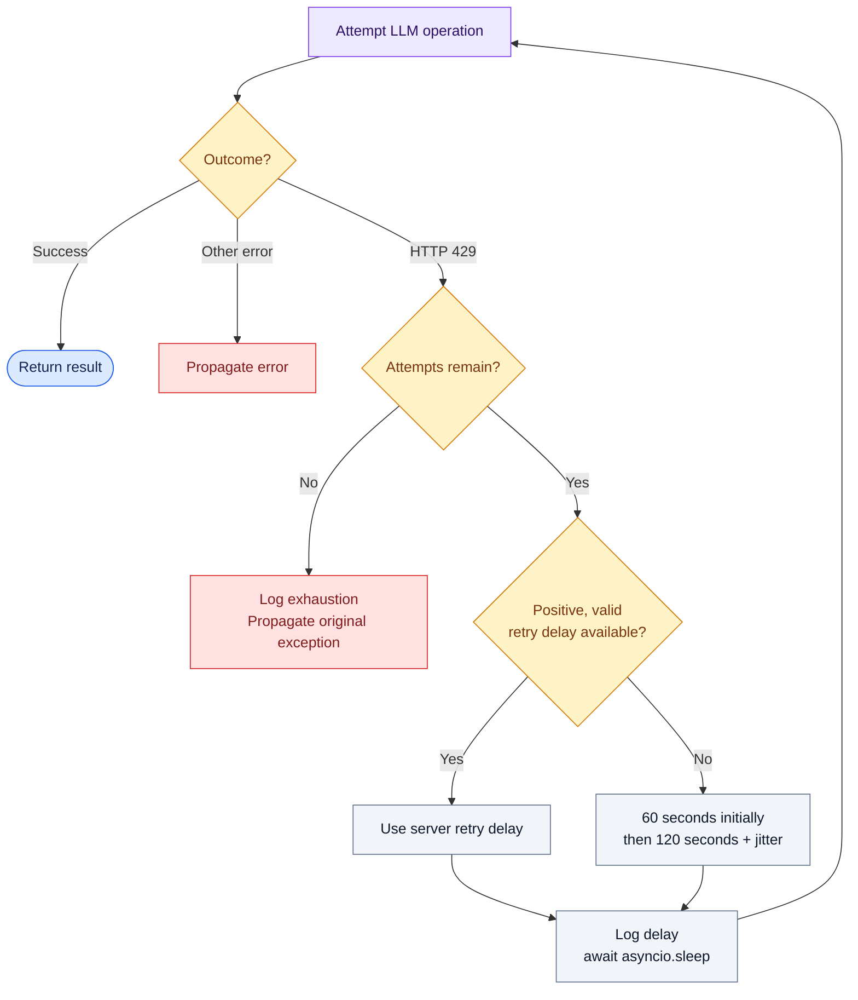

# Database Agent: Architecture and Execution

**Current mode: AI-description-only SQL generation.**

Read the overview first, then follow the numbered diagrams for implementation detail.
GitHub renders these Mermaid diagrams directly; VS Code needs a Mermaid-capable
Markdown preview.

## Visual key

| Color / shape | Meaning |
|---|---|
| Blue rounded box | User input or output |
| Purple box | LLM operation |
| Teal cylinder | Persistent database or memory |
| Amber diamond | Decision or validation |
| Gray box | Local processing |
| Red box | Failure |
| Solid arrow | Execution or data flow |
| Dashed arrow | Supporting data, configuration, or feedback |

## 1. The big picture

**Two stages, one important boundary:** schema is visible during learning, but only
the resulting descriptions are supplied as schema context during SQL generation.

**Not injected into SQL prompts:** raw stored table definitions, sample rows, or live
SQLite DDL. The optional schema-augmentation code remains commented out.

## 2. Startup: reuse or rebuild?

**Debugging tip:** `--rebuild` takes the learning path; otherwise a saved agent can
skip that entire section.

Learning updates `agent_memory.db`, not the source database. Existing descriptions
are not automatically refreshed when their generation prompts change.

## 3. One question: who calls whom?

**This is the main breakpoint map.** Reading downward follows the awaited operations;
the model calls are sequential within this request.

The final steps occur only after a successful SQL attempt. Failed calls propagate
errors instead of continuing with fabricated results. Rate-limit retries wrap the
LLM operations separately; see diagram 5.

Current UTC date is supplied to rewriting, SQL generation, and final-answer context.
"Last month" means the previous calendar month, not the latest month available in
the dataset.

### Retrieval strategies at a glance

Both searches in hybrid use the same question and memory. Each branch selects up to
`min(top_k * 5, 100)` candidates. Fusion deduplicates records and uses UUIDs to break
equal scores. The branches are logically independent but executed sequentially in
the current implementation. Neither strategy injects raw schema.

## 4. Simulation: one agent, ten independent questions

- Cases run **sequentially**, making breakpoints predictable.
- The same agent and memory are reused, but no shared conversation history is passed.
- Expected answers are displayed for comparison; they are not sent as hints to the agent.
- There is no evaluator score or answer-similarity assertion.
- `--verbose` enables existing SQL/result logs and rewritten-question debug logs.
- Simulation uses live Azure calls and can incur charges.

## 5. Two different retry loops

Do not confuse **transport throttling** with **SQL correction**:

| Loop | Trigger | Budget | What changes on retry? |
|---|---|---|---|
| Model-call retry | OpenAI HTTP 429, including SK-wrapped errors | 5 total attempts by default | Wait, then retry the model operation |
| SQL correction | Query generation, filtering, or execution failure other than an exhausted 429 | 3 total SQL attempts | Supply previous SQL and error to the model |

Header priority: `retry-after-ms`, `x-ms-retry-after-ms`, then `retry-after`
(seconds or HTTP date). Zero, negative, invalid, or elapsed values are skipped.
The fallback includes jitter on the initial wait too.

The configured OpenAI client has SDK retries disabled. An exhausted 429 is not
restarted by the outer SQL-correction loop.

## Breakpoint guide

| Goal | Start here |
|---|---|
| CLI options and simulation loop | [main.py](src/main.py) |
| Cache decisions and learning | [DatabaseAgentFactory.py](src/DatabaseAgent/DatabaseAgentFactory.py) |
| Rewritten question and final answer | [DatabaseAgent.py](src/DatabaseAgent/DatabaseAgent.py) |
| Retrieved descriptions, SQL, and correction feedback | [DatabasePlugin.py](src/DatabaseAgent/DatabasePlugin.py) |
| Baseline ranking or independent hybrid search and fusion | [DescriptionRetrievers.py](src/DatabaseAgent/DescriptionRetrievers.py) |
| Retry headers, delays, and exception handling | [RetryHelper.py](src/DatabaseAgent/Internals/RetryHelper.py) |
| Full configuration and optional augmentation instructions | [README](readme.md) |
