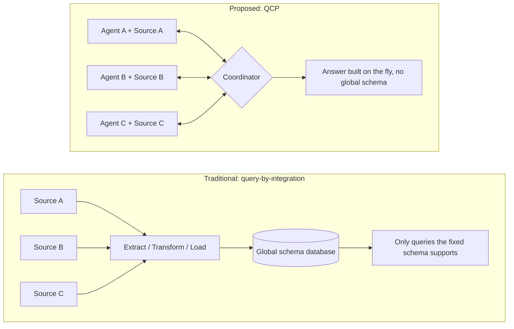
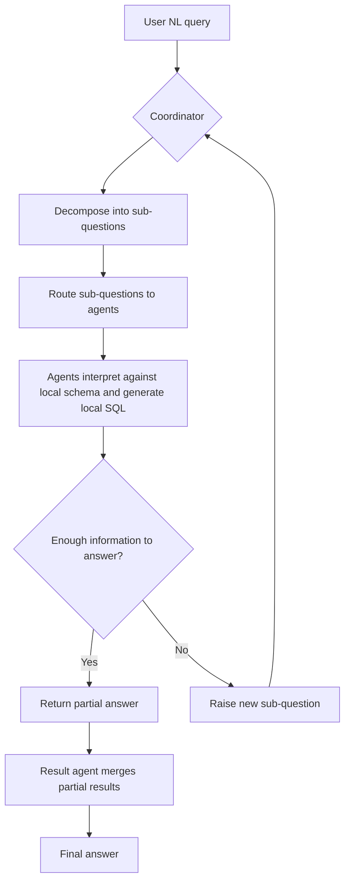
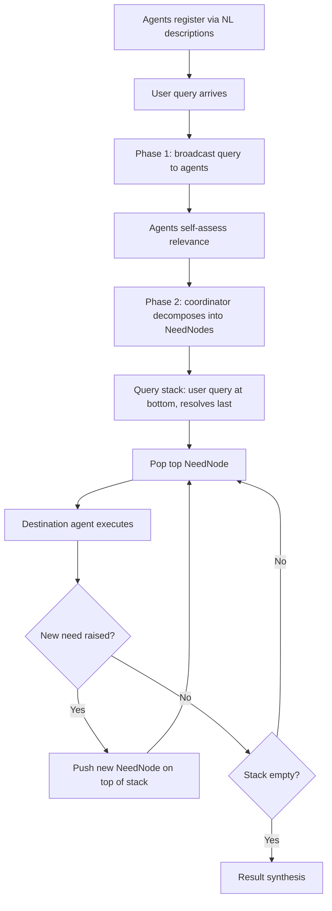
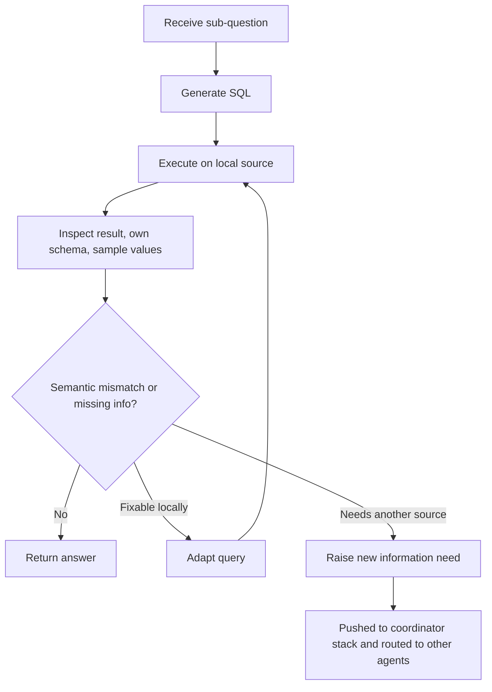
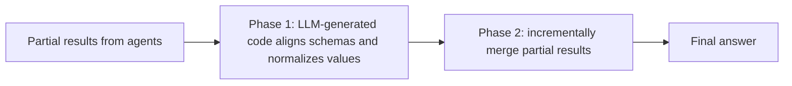
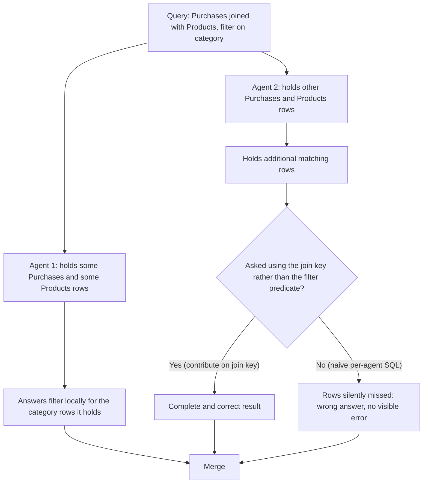
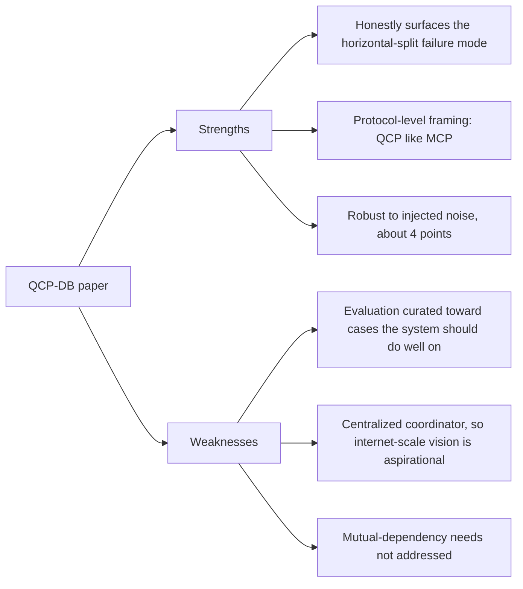

# A Vision for Autonomous Data Agent Collaboration

**Eckmann & Binnig, CIDR 2026** — paper breakdown with flow diagrams

---

## TL;DR

Instead of merging all data sources into one database before you can query them, give each source its own AI agent. The agents negotiate over natural-language sub-questions through the **Query Collaboration Protocol (QCP)** and build the answer on the fly, with no global schema. The prototype, **QCP-DB**, roughly matches a centralized Text-to-SQL baseline on multi-source queries under some data splits, at a modest accuracy cost.

---

## The problem

Answering natural-language queries that span multiple heterogeneous, disparate data sources currently requires integrating them into a centralized database with a global schema before querying can happen. The sources may have no explicit PK/FK relationships and may represent the same real-world entities inconsistently (e.g. city names in different languages or abbreviations).

## Why it matters

- ETL-based integration is costly to build and maintain.
- Once integrated, the answerable queries are constrained by the fixed schema. A query outside it (e.g. a region or attribute the integration never modeled) can't be asked without re-integrating.
- It gets worse as the number, heterogeneity and rate of change of sources increase.
- The paper motivates this at the scale of companies with many internal or cross-company sources (e.g. medical data). The authors frame QCP as eventually enabling internet-scale, open-ended querying across autonomous agents, analogous to how the internet decentralized access to information.

## Current approaches and the gap

Traditional query-by-integration builds a global schema via ETL pipelines and semantic alignment. It worked when sources grew slowly, but doesn't scale with heterogeneity and dynamism. Classical data federation and mediator-based systems still rely on some upfront schema alignment or wrapper mapping.

Other multi-agent data-processing frameworks exist (a general Data Agent architecture, and AutoTQA for tabular QA), but they don't specifically target collaborative query answering across disparate sources without a shared schema. The authors position QCP as the first protocol-level design for this setting.

### Diagram 1: ETL vs. QCP

---

## What the paper proposes

A network of autonomous data agents, each wrapping one data source and advertising what it knows in natural language. A coordinator receives the user's NL query, decomposes it into sub-questions and routes them to agents. Agents interpret each sub-question against their local schema, generate local queries (e.g. SQL), and either answer or raise a new sub-question if they're missing information.

This is formalized as the **Query Collaboration Protocol (QCP)**: declarative for data querying the way MCP is declarative for tool integration. The prototype **QCP-DB** targets relational data.

### Diagram 2: End-to-end query flow

## How it works

Agents register with the coordinator via natural-language descriptions of their data and query capabilities. On a query:

1. **Two-phase routing.** Agents self-assess relevance from a broadcast query, then the coordinator decomposes the query into a stack of **NeedNodes** (sub-questions, each with destination agents and an originator), processed in dependency order.
2. **Agent generate-feedback loop.** An agent generates SQL, executes it, inspects the result and its own schema/sample values, then adapts the query or raises a new information need if there's a semantic mismatch (e.g. it needs a country-to-city mapping it doesn't have). New needs are pushed back onto the coordinator's stack and routed to other agents.
3. **Two-phase synthesis.** A result agent uses LLM-generated code to align schemas and normalize values (e.g. 'Munich' / 'München' / 'MUC'), then incrementally merges partial results and produces the final answer.

### Diagram 3: Two-phase routing and the NeedNode stack

### Diagram 4: Agent generate-feedback loop

### Diagram 5: Two-phase result synthesis

### Design notes

- **NeedNode stack.** Decomposition is trackable: each node carries a sub-question, candidate destination agents and an originator, with the user's original query at the bottom so it resolves last. New needs raised mid-execution are pushed on top, so dependency ordering is implicit in stack position rather than an explicit DAG. The paper does not address what happens if two independently raised needs turn out to have a mutual dependency.
- **Alignment happens at synthesis time.** Schema/value alignment (mapping 'corp_name' / 'company' to one column; normalizing 'München' / 'MUC' / 'Munich') is LLM-generated Python code at result-merge time, not negotiated between agents beforehand.

---

## Results

Evaluated on a fragmented version of the BIRD text-to-SQL benchmark: 50 hand-selected queries that require multi-agent coordination, 4 agents.

| Setup | Horizontal split | Vertical split | Random split |
|---|---|---|---|
| QCP-DB, strong model (o3 coordinator + GPT-4.1 agents) | 62% | 60% | 54% |
| QCP-DB, weaker model pairing | 50% | 42% | 32% |
| Centralized Text-to-SQL baseline | 62% | | |

- The strong model roughly matches the centralized baseline (62%) under horizontal and vertical splits, and drops more under random splits.
- Scaling from 4 to 7 agents under random splits degrades gracefully (54% to 44%).
- Injecting data/schema noise (renaming, abbreviations, cross-language translation) cost only about 4 percentage points, with translation to German having no measurable effect.
- Because alignment happens at synthesis time, the noise result is really a claim about the alignment step's robustness, not about routing or decomposition. The vertical split used for it is the authors' own "most challenging scenario for result alignment."

---

## The hard case: horizontal splits

The Section 4 anecdote is the most technically interesting result. Horizontal splits (row-wise partitions) look like they should be trivial, since it's just concatenation. But the authors show a concrete case, a Purchases/Products join split across two agents by row, where the agent holding the matching category rows can answer part of the filter locally, while the other agent holds additional matching rows it can't discover unless it's asked to contribute using the **join key** rather than the original filter predicate.

Correct handling therefore requires an agent to recognize it should contribute on a different basis than the query it was literally asked. A naive per-agent SQL-generation approach would miss this silently: the result is a wrong answer, not a visible error.

### Diagram 6: Horizontal-split failure mode

---

## Critical assessment

### Evaluation caveats
- The 50 BIRD queries were hand-selected because they need multi-agent coordination. That's reasonable, but the accuracy describes a curated slice, not BIRD broadly.
- The paper states most BIRD queries remain answerable by a single partition even after fragmentation, which somewhat undercuts the premise that real queries need collaboration as often as the framing implies.
- The coordinator is currently centralized (distributing it is future work), so the internet-scale vision is further away than the working prototype.

### Positioning vs. prior work
The novelty claim is specifically being first to design a protocol for collaborative query answering without a global schema, not first to apply multi-agent LLM systems to data tasks generally. The QCP-vs-MCP analogy (declarative data querying like declarative tool integration) is the central framing of the contribution.

### Diagram 7: Strengths vs. weaknesses

### Bottom line

The core bet is that a declarative, MCP-like protocol for agent-to-agent negotiation can substitute for upfront schema integration, at a modest accuracy cost that seems to hold up under injected heterogeneity. The strongest part is the horizontal-split anecdote, which honestly surfaces a real, non-obvious failure mode. The weakest part is that the evaluation is curated toward cases the system should do well on, and the centralized coordinator means the "internet-scale" vision is aspirational, not demonstrated.